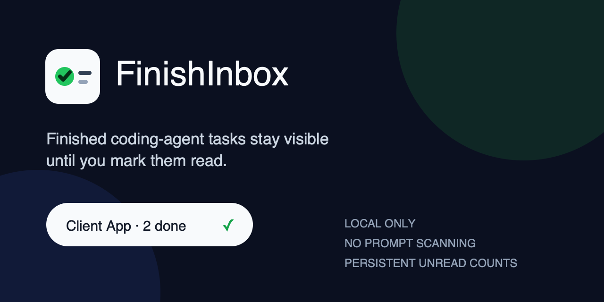

# FinishInbox Free

Keep completed Codex tasks and conversations awaiting your reply in the macOS menu bar.

## [Download the free notarized app for macOS](https://github.com/jack1231222/finish-inbox/releases/download/v0.2.0-free-preview.1/FinishInbox-Free-0.2.0-notarized-macos.zip)

**Apple notarized · Free to use · No subscription · No build tools or Python required**

Recommended download: `FinishInbox-Free-0.2.0-notarized-macos.zip`

[SHA-256 checksum](https://github.com/jack1231222/finish-inbox/releases/download/v0.2.0-free-preview.1/FinishInbox-Free-0.2.0-notarized-macos.zip.sha256) · [Release page](https://github.com/jack1231222/finish-inbox/releases/tag/v0.2.0-free-preview.1) · [Installation and privacy](FREE-EDITION.md) · [Chinese guide](README.zh-CN.md)

### Get started

1. Download and unzip the app, then drag **FinishInbox Free.app** into **Applications**.
2. Open it and choose whether to enable local Codex monitoring.
3. Check completion counts and pending replies in the menu bar. Use the **F✓** menu to pause monitoring or quit.

This is a free preview, signed with Developer ID and supplied with an Apple notarization ticket. macOS may show its normal internet-download confirmation. The app does not remove quarantine attributes or change security settings.

The download includes Apple Silicon and Intel binaries targeting macOS 13 or later. Download and launch were tested on **macOS 27 / Apple Silicon**. Intel and older macOS versions have not been tested on hardware.

### Privacy and source code

Codex events and pending-conversation metadata are processed locally, with no uploads or cloud analytics. The current Free edition is distributed as a compiled app; its source code is not public. The publisher's name appears only in the signing certificate. No other personal information, chat history, or machine configuration is bundled.

---

## Historical versions — reference only

**The older installers and source below are historical releases, not the current notarized Free app.** Assets marked **Historical / Not notarized** are retained for reference and are not recommended downloads. GitHub's automatically generated **Source code (zip / tar.gz)** archives contain historical open-source code, not the current Free implementation or app.

<details>
<summary>Historical open-source 0.1.0: introduction and source installation</summary>

# FinishInbox

[](https://github.com/jack1231222/finish-inbox/actions/workflows/ci.yml)
[](https://github.com/jack1231222/finish-inbox/releases)
[](LICENSE)



**A quiet macOS menu bar inbox for completed coding-agent tasks.**

FinishInbox turns explicit completion events from Codex, Claude Code, or any
local script into persistent unread counters. Each project stays visible in the
menu bar until you click it clear.

```text
Client App · 2 done ✓
```


No prompt scanning. No response history. No cloud service.

If FinishInbox solves this problem for you, a star helps more coding-agent
users find it. Have an integration request? [Tell me what should come
next](https://github.com/jack1231222/finish-inbox/discussions/1).

[Chinese](README.zh-CN.md)

## Why this exists

Desktop notifications disappear. Terminal tabs get buried. When several agents
finish at once, it is easy to forget which project still needs review.

FinishInbox keeps one small, durable signal:

- completion events accumulate by project;
- repeated event IDs are deduplicated;
- clicking a project marks only that project as read;
- counts survive app restarts;
- private task text never enters the state file.

FinishInbox does not decide whether an agent's work is actually correct. Your
integration emits the event after its own verification step.

## Quick start

### Build and install from source

Requirements: a Swift 6 toolchain (Xcode 16 or later). The built app targets
macOS 13 or later.

```bash
git clone https://github.com/jack1231222/finish-inbox.git
cd finish-inbox
./scripts/install.sh
```

Map the current directory to the label you want to see:

```bash
~/.local/bin/finish-inbox map "Client App"
```

Send a completion event:

```bash
~/.local/bin/finish-inbox notify
```

Useful checks:

```bash
~/.local/bin/finish-inbox status
~/.local/bin/finish-inbox doctor
```

### Downloaded preview builds

The current preview is ad-hoc signed, not Apple-notarized. macOS may block a
downloaded build until you explicitly allow it in **System Settings → Privacy &
Security**. Building from source is the smoother path until a notarized release
is available. FinishInbox never removes macOS quarantine attributes for you.

If you use the preview archive, download its matching `.sha256` file and verify
it before opening `install.command`:

```bash
shasum -a 256 -c FinishInbox-v0.1.0-preview.1.zip.sha256
```

See the [preview release](https://github.com/jack1231222/finish-inbox/releases/tag/v0.1.0-preview.1)
and Apple's [unknown-developer guidance](https://support.apple.com/guide/mac-help/open-a-mac-app-from-an-unknown-developer-mh40616/mac).

## Codex integration

Add this rule to a project or global `AGENTS.md` after installing FinishInbox:

```text
After a substantive task is complete and the required verification has passed,
run ~/.local/bin/finish-inbox notify before the final reply. If this directory
has not been mapped yet, ask for a short private display label and run
~/.local/bin/finish-inbox map "<label>" first. A notifier failure must not hide
the task result.
```

For other tools, call `finish-inbox notify` from their completion or stop hook.
See [integration notes](docs/INTEGRATIONS.md).

## Privacy model

Runtime data stays in:

```text
~/Library/Application Support/FinishInbox/
```

FinishInbox stores only:

- your private directory-to-label mappings;
- project labels and unread counts;
- bounded recent event IDs and timestamps.

It does not read or store prompts, model responses, source files, terminal
output, API keys, or complete agent session logs. Private directories use mode
`0700`; config and state files use mode `0600`.

Read the full [privacy notes](docs/PRIVACY.md).

## Commands

```text
finish-inbox map <label>       Map the current directory
finish-inbox unmap             Remove the current directory mapping
finish-inbox notify            Record one completion
finish-inbox clear <project>   Clear a project counter
finish-inbox status            Show unread totals without project paths
finish-inbox doctor            Check installation and private permissions
finish-inbox preview           Print a label without changing state
```

Run `finish-inbox help` for the exact options in your installed version.

## Feedback and upgrades

- [Ideas and integration requests](https://github.com/jack1231222/finish-inbox/discussions/1)
  stay open for comments and voting.
- [Questions and setup help](https://github.com/jack1231222/finish-inbox/discussions/categories/q-a)
  belong in Q&A.
- [Reproducible bugs](https://github.com/jack1231222/finish-inbox/issues/new?template=bug_report.yml)
  become tracked issues.
- Security reports use the [private advisory form](https://github.com/jack1231222/finish-inbox/security/advisories/new).

See how feedback becomes a tested release in the
[feedback and upgrade loop](docs/FEEDBACK.md).

## Build and test

```bash
swift test
./scripts/integration-stress.py
./scripts/build-app.sh
./scripts/app-launch-smoke.py
./scripts/package-release.sh
```

The core test suite covers mapping resolution, input validation, private file
permissions, durable event ordering, idempotency, corrupt-state handling,
bounded history, project isolation, restart recovery, and the deterministic
menu-bar visible/overflow projection. The app-launch smoke test additionally
exercises real manager processes, single-manager locks, and project-isolated
clearing across two independent state roots. It does not replace the release
check for clearing projects through the same manager's real AppKit status-item
click path.

See [architecture](docs/ARCHITECTURE.md) and the explicit
[state invariants](docs/PRODUCT_SPEC.md). Common recovery steps are in
[troubleshooting](docs/TROUBLESHOOTING.md).

## Release status

`v0.1.0-preview.1` is a technical preview. The repository and release pipeline
are public and reproducible; downloaded binaries remain unnotarized until a
Developer ID signing identity is available. This limitation is reported in
release metadata instead of being hidden by an unsafe quarantine-removal
installer.

## Contributing

Small, focused changes are welcome. Please read [CONTRIBUTING.md](CONTRIBUTING.md)
before opening a pull request. Security reports belong in the private channel
described in [SECURITY.md](SECURITY.md), not in a public issue.

MIT License.

</details>
